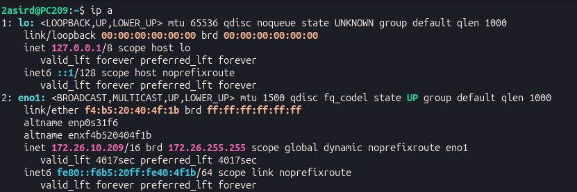
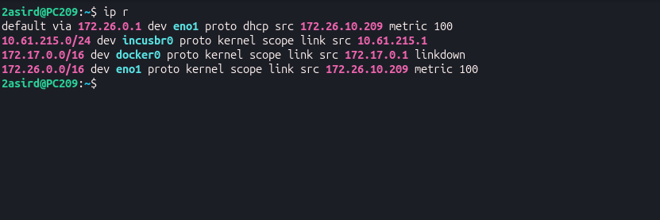
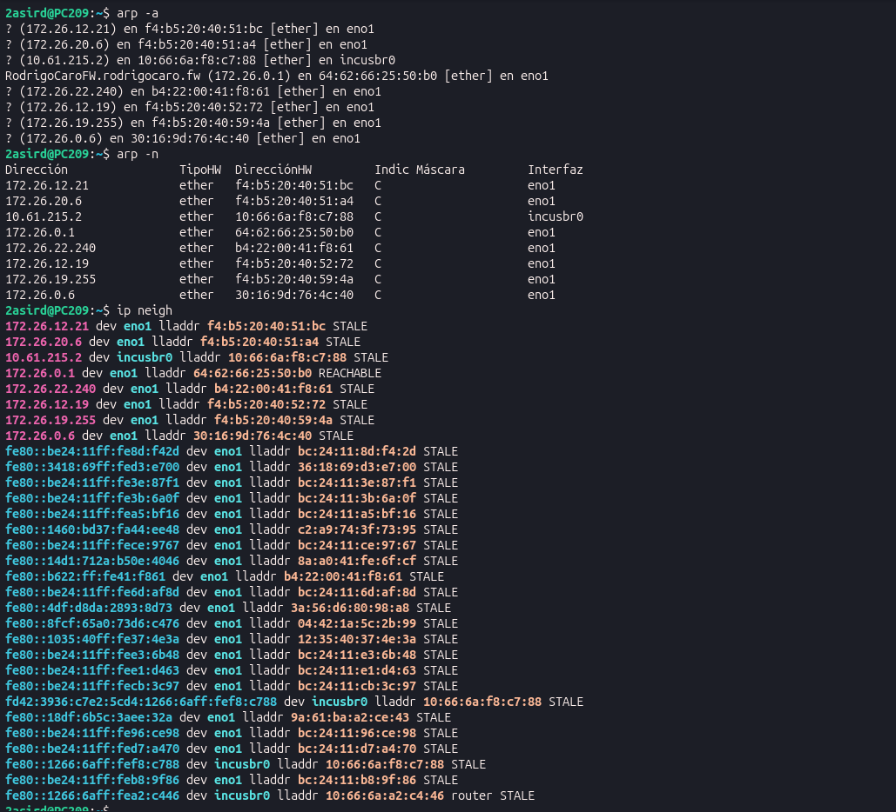
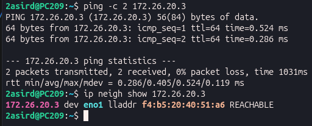
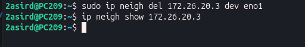
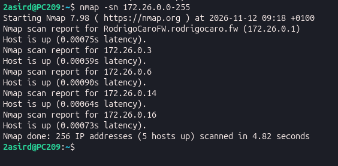
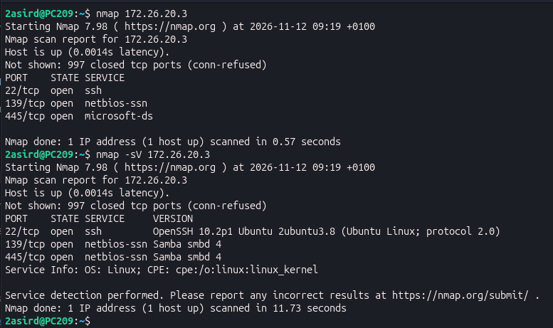

# Ejercicio práctico de monitorización de red

> Realiza las comprobaciones únicamente en tu equipo y en redes o dispositivos
> para los que tengas autorización.

## 1. Identificar la configuración de red

Consulta la configuración de las interfaces y las rutas:

```bash
ip a
ip r
```

| Dato | Resultado |
| --- | --- |
| Interfaz de red | `eno1` |
| Dirección IPv4 | `172.26.10.209/16` |
| Puerta de enlace predeterminada | `172.26.0.1` |
| Dirección de red | `172.26.0.0/16` |





## 2. Consultar y renovar una entrada ARP

El profesor proporcionará la IP de su equipo. Comprueba que pertenece a la red
local y consulta la tabla de vecinos con estos comandos:

```bash
arp -a
arp -n
ip neigh
```

| Comando u opción | Descripción |
| --- | --- |
| `arp -a` | Muestra las entradas ARP en un formato legible. |
| `arp -n` | Muestra las direcciones sin resolverlas a nombres. |
| `ip neigh` | Consulta la tabla local de vecinos IP y sus direcciones de enlace. |

La dirección MAC asociada a la puerta de enlace `172.26.0.1` es
`64:62:66:25:50:b0`. La tabla ARP no necesariamente muestra todos los equipos
de la red: contiene vecinos que el equipo ha descubierto y cuyas entradas aún
conserva.



Para generar y consultar la entrada del equipo del profesor (en este ejemplo,
`172.26.20.3`):

```bash
ping -c 2 172.26.20.3
ip neigh show 172.26.20.3
```

La entrada observada para `172.26.20.3` muestra la MAC
`f4:b5:20:40:51:a6`.



Para eliminar únicamente esa asociación local, usa la interfaz correspondiente
a tu equipo. Puede ser necesario ejecutar el comando con `sudo`:

```bash
sudo ip neigh del 172.26.20.3 dev eno1
ip neigh show 172.26.20.3
```

Si necesitas volver a generar la entrada, consulta el equipo de nuevo:

```bash
ping -c 2 172.26.20.3
ip neigh show 172.26.20.3
```



## 3. Descubrir equipos con `nmap`

En la red autorizada para el ejercicio, descubre los equipos activos del rango
`172.26.20.0/24`:

```bash
nmap -sn 172.26.20.0/24
```

La opción `-sn` descubre los equipos activos sin realizar un escaneo de puertos.



## 4. Examinar puertos y servicios

Escanea únicamente la máquina objetivo indicada por el profesor. En este ejemplo,
la dirección es `172.26.20.3`:

```bash
nmap 172.26.20.3
nmap -sV 172.26.20.3
```

La opción `-sV` intenta identificar los servicios y sus versiones en los puertos
detectados.


