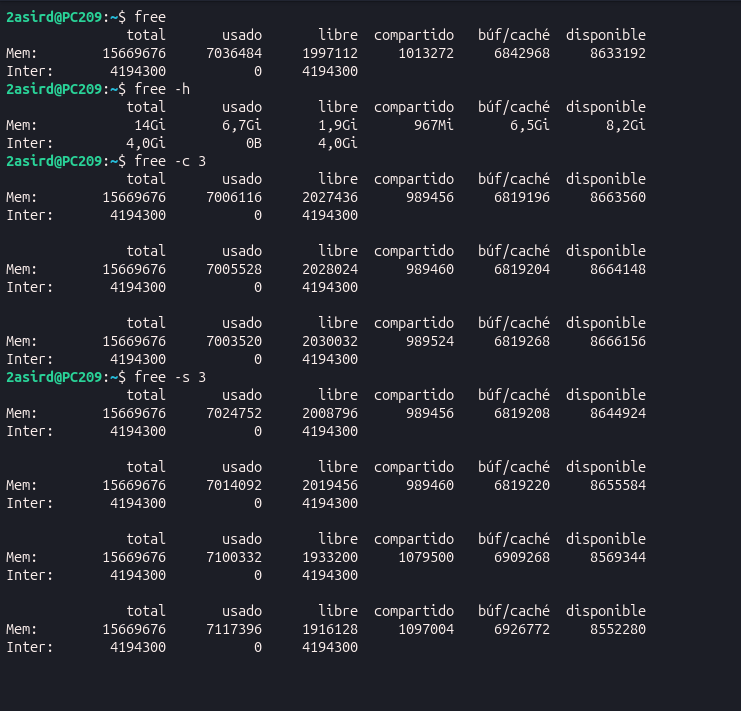
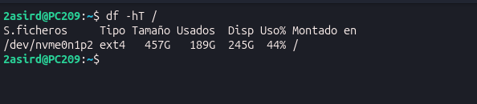
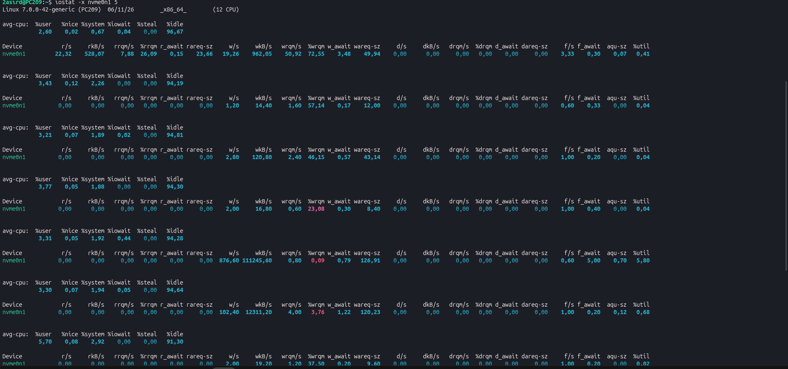

# Memoria, espacio y rendimiento del disco

## Consultar la memoria con `free`

`free` muestra la cantidad de memoria libre y utilizada en el sistema.

| Comando | Descripción |
| --- | --- |
| `free -h` | Muestra las cantidades en un formato legible para las personas. |
| `free -c 3` | Muestra tres informes consecutivos de memoria. |
| `free -s 3` | Actualiza el informe cada tres segundos. |



## Consultar el espacio de los sistemas de archivos con `df`

`df` muestra el espacio utilizado y disponible en los sistemas de archivos montados.

| Comando | Descripción |
| --- | --- |
| `df -h` | Muestra el espacio en un formato legible. |
| `df -hT` | Muestra el espacio y el tipo de cada sistema de archivos. |
| `df -hT /` | Muestra la información del sistema de archivos raíz (`/`). |



## Consultar el espacio de directorios con `du`

`du` permite consultar el espacio ocupado por archivos y directorios.

| Comando | Descripción |
| --- | --- |
| `du -hs /home` | Muestra el tamaño total de `/home` en un formato legible. |
| `du -hs /home/*` | Muestra el tamaño de cada elemento dentro de `/home`. |

## Consultar el rendimiento de dispositivos con `iostat`

`iostat` se utiliza para detectar problemas de rendimiento en dispositivos de almacenamiento. La opción `-x` permite consultar un dispositivo concreto en detalle.

| Comando | Descripción |
| --- | --- |
| `iostat` | Muestra estadísticas de CPU y dispositivos de almacenamiento. |
| `iostat -x` | Muestra información detallada de cada dispositivo. |



## Resumen de comandos

```bash
free -h
free -c 3
free -s 3
df -h
df -hT
df -hT /
du -hs /home
du -hs /home/*
iostat
iostat -x
```
