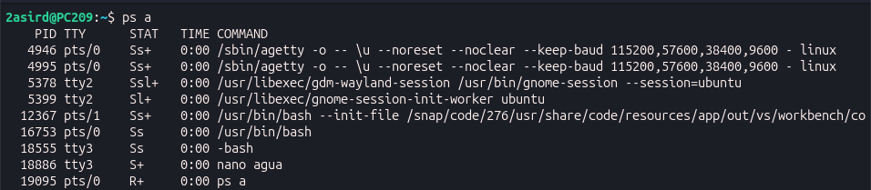
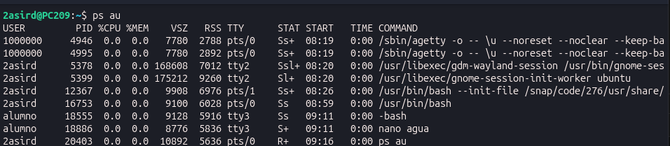
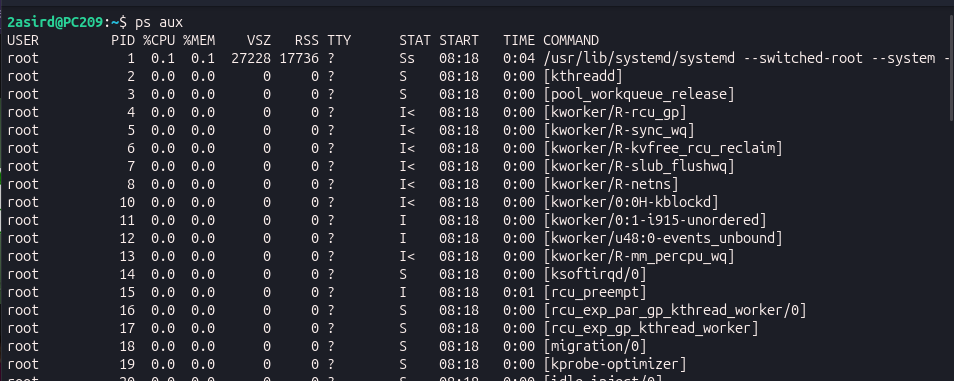
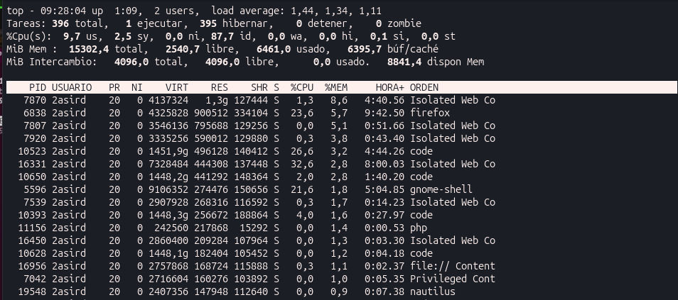
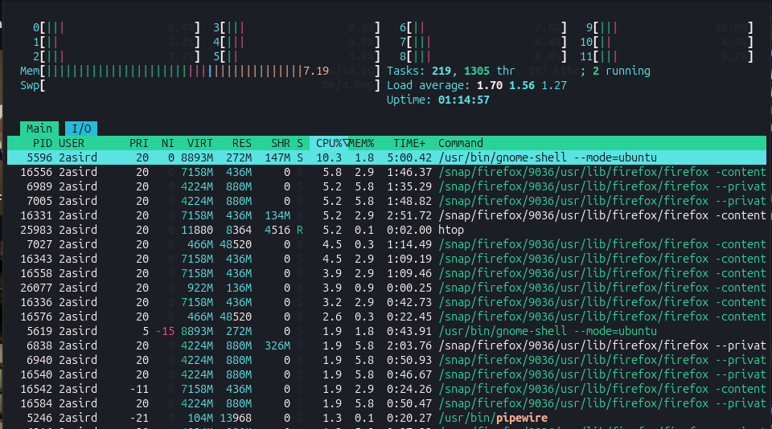

# Procesos

## Consultar procesos con `ps`

`ps` muestra información sobre los procesos. Las opciones permiten elegir qué procesos consultar y qué datos mostrar.

| Comando | Descripción |
| --- | --- |
| `ps` | Muestra los procesos asociados a la sesión actual. |
| `ps a` | Incluye procesos de otras sesiones conectadas al terminal. |
| `ps au` | Muestra información ampliada, como el usuario y el uso de memoria. |
| `ps aux` | Muestra todos los procesos del sistema con información detallada. |
| `ps u -C nombre` | Busca procesos por nombre de comando y muestra información ampliada. |

### Ejemplos de salida de `ps`

**`ps a`:**



**`ps au`:**



**`ps aux`:**



**`ps u -C nano`:**


## Monitorización interactiva

### `top`

Muestra los procesos y actualiza periódicamente la información de consumo.

Dentro de `top`, se pueden ordenar los procesos con estas teclas:

| Tecla | Orden |
| --- | --- |
| `M` | Uso de memoria |
| `P` | Uso de CPU |
| `T` | Tiempo de uso |
| `N` | PID |
| `R` | Invierte el orden actual |



Para ejecutar `top` en modo no interactivo y guardar tres actualizaciones en un archivo:

```bash
top -b -n 3 > top.info
```

- `-b`: activa el modo por lotes, sin interacción.
- `-n 3`: realiza tres iteraciones.
- `>`: redirige la salida a `top.info`.

### `htop`

Es una alternativa más visual a `top`, con opciones de búsqueda y navegación.

- Pulsa `F3` para buscar un proceso.



### `atop`

Puede registrar información de actividad del sistema. Su configuración se encuentra en `/etc/default/atop` y los registros se guardan en `/var/log/atop/`.

Para consultar los registros:

```bash
atop -r
```

Dentro del visor, pulsa `t` para avanzar entre registros y `T` para retroceder.

## Ejercicio

Usa `top` para enviar al archivo `info.txt` los diez primeros procesos que aparezcan.

## Resumen de comandos

```bash
ps
ps a
ps au
ps aux
ps u -C nombre
top
top -b -n 3 > top.info
htop
atop
atop -r
```
