# Tráfico de la red

## Consultar tráfico con `tcpdump`

`tcpdump` analiza el tráfico de la red y permite capturar paquetes para su revisión.

| Opción | Descripción |
| --- | --- |
| `-v` | Muestra más información. |
| `-i` | Indica la interfaz a monitorizar. |
| `-n` | No resuelve nombres de host ni puertos. |
| `-w` | Guarda la captura en un archivo. |
| `-r` | Lee una captura guardada previamente. |

```bash
tcpdump -i eth0 -n
# Guardar la captura en un archivo
tcpdump -i eth0 -w captura.pcap
# Leer la captura guardada
tcpdump -r captura.pcap
```

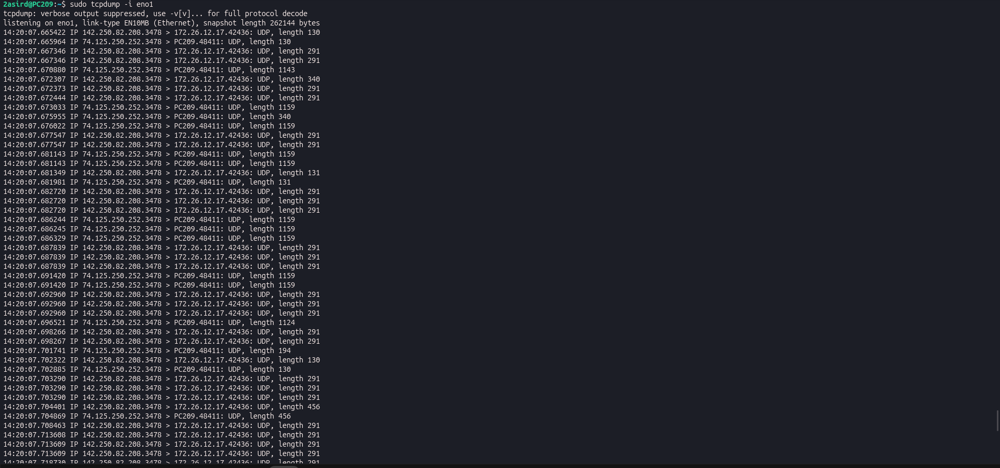

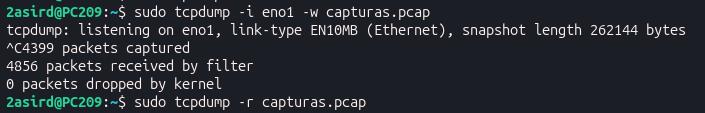

## Consultar conexiones activas con `tcptrack`

`tcptrack` muestra las conexiones activas del sistema con información útil sobre el flujo de red.

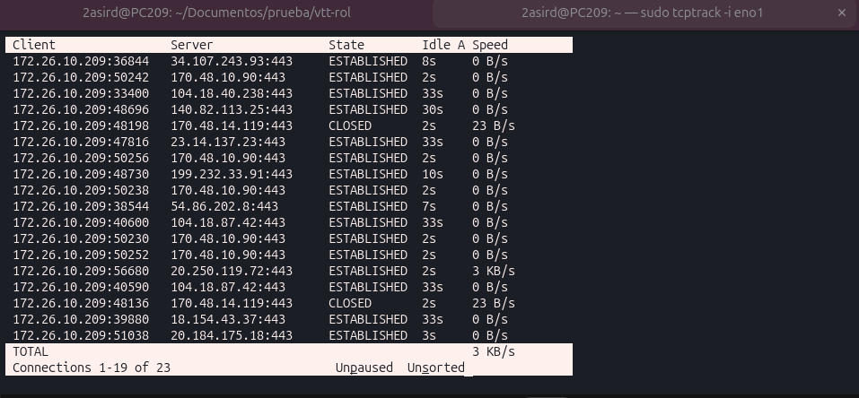

## Consultar información IP con `whois`

`whois` muestra información asociada a una dirección IP o dominio.

```bash
whois x.x.x.x
```

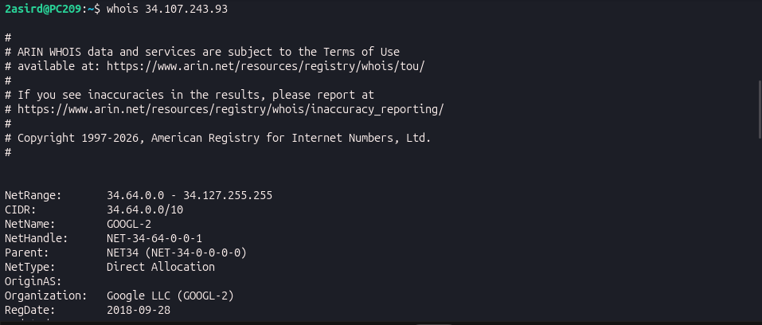

## Consultar el tráfico de forma más visual con `iptraf`

`iptraf` ofrece un resumen visual de las conexiones y del tráfico del sistema.

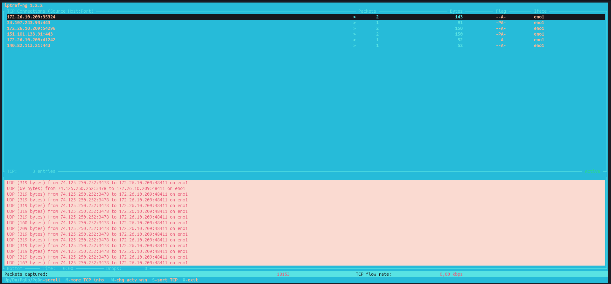

## Consultar estadísticas de paquetes con `bmon`

`bmon` permite visualizar de forma gráfica el tráfico y el uso de la red.

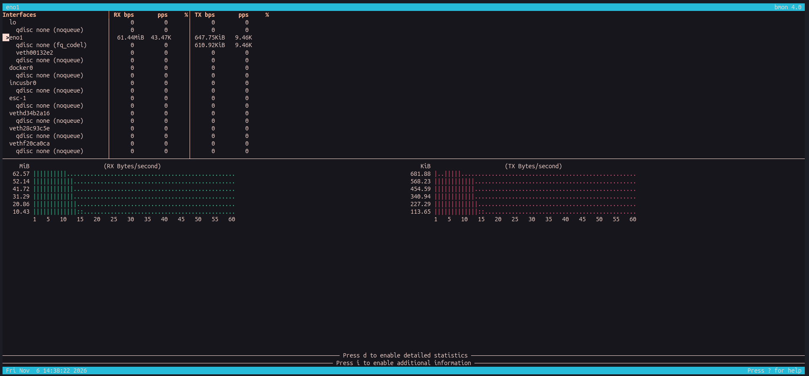

## Consultar los puertos abiertos del equipo con `ss`

`ss` muestra sockets y puertos abiertos. Las opciones más habituales son:

| Opción | Descripción |
| --- | --- |
| `-p` | Muestra el proceso asociado. |
| `-l` | Muestra solo los sockets escuchando. |
| `-u` | Muestra sockets UDP. |
| `-n` | Muestra puertos en formato numérico. |
| `-t` | Muestra sockets TCP. |

```bash
ss -plunt
ss -tnp
```

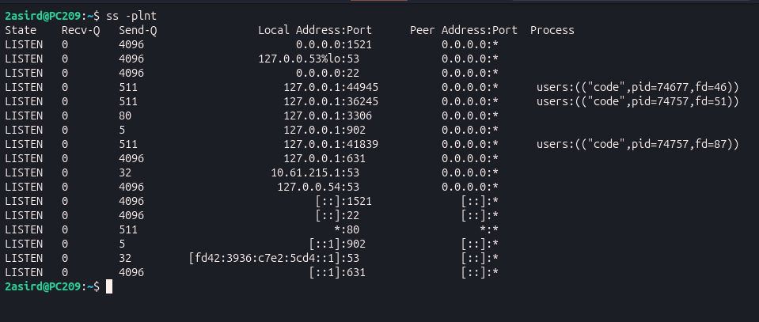

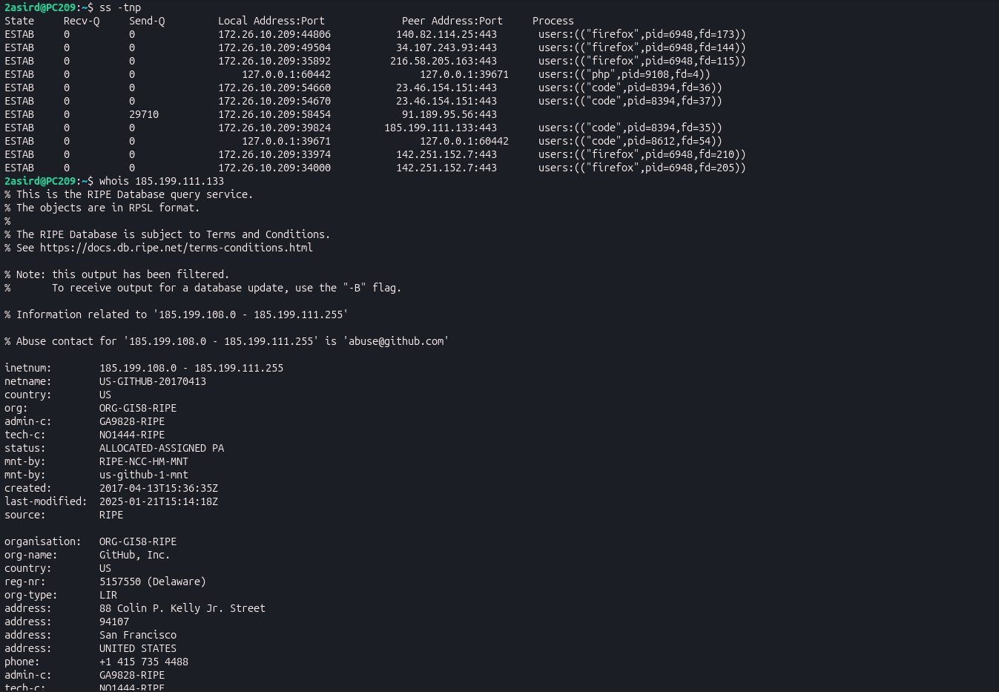


## Explorar una red con `nmap`

`nmap` permite descubrir equipos disponibles y consultar los servicios expuestos. Utilízalo únicamente en equipos y redes propios o para los que tengas autorización.

| Opción | Descripción |
| --- | --- |
| `-sn` | Descubre los equipos activos sin escanear sus puertos. |
| `-sV` | Detecta los servicios y sus versiones en los puertos encontrados. |

```bash
nmap -sn x.x.x.x/x
nmap -sV x.x.x.x
```

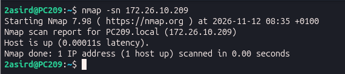

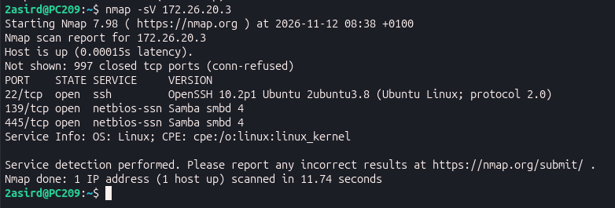

## Consultar la tabla ARP con `arp`

`arp` permite consultar la tabla local que relaciona direcciones IP con direcciones MAC. La opción `-n` muestra las direcciones sin resolverlas a nombres.

```bash
arp -n
```

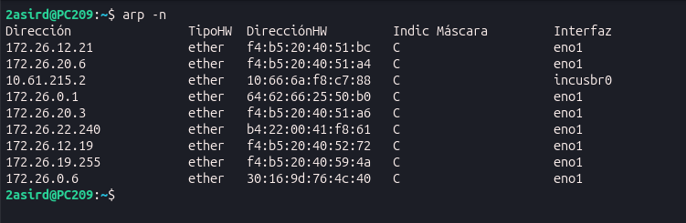

## Resumen de comandos

```bash
tcpdump -i eth0 -n
tcpdump -i eth0 -w captura.pcap
tcpdump -r captura.pcap
tcptrack
whois x.x.x.x
iptraf
bmon
ss -plunt
nmap -sn x.x.x.x/x
nmap -sV x.x.x.x
arp -n
```